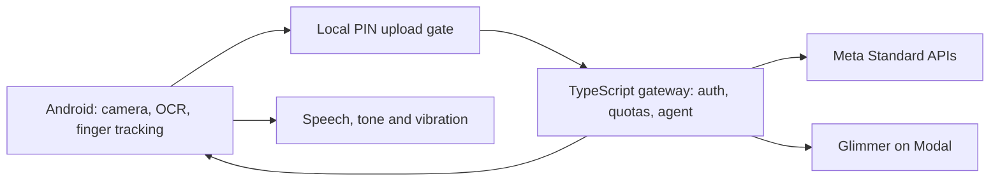

# Fingerpost

Fingerpost helps blind and low-vision Android users find a control on a flat touchscreen using speech, tones and vibration. It supports single targets, multi-step tasks, screen summaries and local PIN assistance. Apache-2.0 licensed.

**Development beta; acceptance is incomplete.** The current source includes the task agent, payment confirmation policy, private model routing, kiosk memory, offline text matching, simulator, evaluation tools and signed-release workflow. Passing synthetic tests does not establish safe real-world guidance. Live recognition quality/latency, device performance, consented trials and release installation still need evidence. See [progress and blockers](docs/progress.md) and [the device handoff](docs/evals/android-integration-handoff.md).

Demo: a 30-second captioned GIF will be added after verified device footage is available.

## Architecture



PIN assistance runs locally with uploads and the microphone stopped; digit speech requires earphones. Private sessions route screen parsing to Glimmer. Cloud inference availability and on-device safety still need deployment/device acceptance.

| Model | Role |
|---|---|
| Muse Spark 1.3, with 1.2 fallback | Screen parsing and task planning |
| SAM 3.1 | Screen and target geometry |
| Voice Transcribe | Streaming cloud speech recognition |
| Muse Glimmer | Private parsing on Modal; deployment/evaluation pending |

## Run the mock stack

Use Node 24.x and pnpm 11.10.0, as pinned in [AGENTS.md](AGENTS.md).

```bash
pnpm install --frozen-lockfile
pnpm -r typecheck
pnpm -r test
MODEL_MODE=mock pnpm --filter @fingerpost/gateway dev
# In another terminal:
pnpm --filter @fingerpost/web dev
```

Open `http://localhost:5173/sim/?scene=fastfood&seed=1`. Mock responses use synthetic layouts: they do not recognize a real appliance. Tablet testing requires the laptop's LAN address and matching simulator run IDs. [Local development](docs/local-development.md) covers phone connectivity and configuration.

```bash
pnpm --filter @fingerpost/evals eval --set mock-panel --mode mock --out ../docs/evals/report-mock.md
```

The [30-minute soak procedure](evals/scripts/soak.md) is ready for teammates; no soak result is implied. SDK-dependent Android builds and physical acceptance can run on a teammate's machine or CI.

The [Day 6 coding checkpoint](docs/evals/day6-coding-completion.md) records the current local results and remaining acceptance. Android JVM tests, debug builds and lint pass. Cloud deployment, signed release installation, physical accessibility/safety, tester sessions and footage remain open.

The [Day 7 release checker](docs/release-readiness.md) produces a [gate report](docs/evals/report-v1.md) from reviewed numeric evidence. Current public release readiness is **BLOCKED**. RC builds stay draft; no public beta is accepted from synthetic tests or missing evidence.

## Project layout

| Path | Purpose |
|---|---|
| `apps/android` | Android app and pure Kotlin guidance/protocol modules |
| `apps/web` | Simulator, label tool and public pages |
| `services/gateway` | Sessions, model adapters, agent, authentication and quotas |
| `services/private-models` | Modal deployment source |
| `packages/protocol` | Shared fp.v1 schemas, fixtures and flow contracts |
| `evals` | Synthetic datasets, eval and virtual-device runners |
| `infra` | Deployment, Firestore and donation storage setup |

Read [AGENTS.md](AGENTS.md), [progress](docs/progress.md), then the [current plan](docs/superpowers/plans/2026-10-30-days4-7-parallel.md). Guidance behavior is defined in [guidance-spec.md](docs/guidance-spec.md); wire messages are in [protocol.md](docs/protocol.md).

Never commit credentials, keystores, personal photos, audio or transcripts. Account setup, tester outreach and billing remain human tasks. Public release is held until the PIN/payment safety gates have been measured and met.
