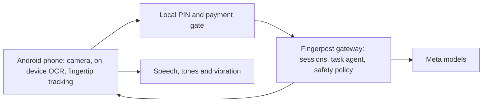

# Fingerpost

**Fingerpost guides a blind or low-vision person's finger to the right spot on a flat touchscreen.** Self-checkouts, ticket machines, check-in kiosks and appliance panels have nothing to feel. Point your Android phone at the screen, say what you want, and Fingerpost reads the screen, finds the button and steers your fingertip onto it with tones, spoken directions and vibration. It confirms each press and can walk you through a whole order, one screen at a time.

Free and open source (Apache-2.0). Built with Meta's models.

## How it works

1. **You say what you want.** "Order a medium cola", "press start", or "read the screen". Speech goes to Meta Voice Transcribe.
2. **Fingerpost reads the screen.** The phone sends a camera frame through the Fingerpost gateway. A Meta vision model lists every control on the screen, and SAM 3.1 outlines the exact button.
3. **It guides your finger.** The phone tracks your fingertip on-device. A tone rises and pans as you get closer, short spoken directions ("right a little", "up") keep you on course, and a buzz says you're on target.
4. **It checks the press.** When the screen changes, Fingerpost confirms it and moves on to the next step, announcing each new screen.



| Meta model | What it does in Fingerpost |
|---|---|
| Voice Transcribe 1.0 | Streams the user's speech into a goal or an answer |
| Muse Wonder 1.0 or Muse Spark 1.3 | Reads the screen into labelled controls, confirms the pressable area and plans multi-step tasks. Spark 1.3 is the default (Spark 1.2 as a fallback); the demo uses Wonder (`VISION_MODEL=muse-wonder-1.0`). |
| SAM 3.1 | Finds the screen in the camera view and outlines the target button |
| Muse Glimmer | Private mode: screen reading on a self-hosted endpoint (Modal), so frames never reach the shared API |

## Safety and privacy

- **PIN pads stay private.** On-device OCR spots a keypad or PIN wording *before* anything is uploaded. Fingerpost then stops all uploads and the microphone, says "Cloud off", and can read digits under your finger through earphones only.
- **Payments need your yes.** Pay, confirm and submit buttons are never guided to until you hear the on-screen amount and say yes.
- **Overcharge warning.** If the total on screen doesn't match what you chose, Fingerpost tells you before you pay.
- Camera frames go only to the Fingerpost gateway. Pictures of the screen and your voice are processed to find buttons, then never stored by Fingerpost. Optional session donations are off by default and always ask first. See the [privacy page](apps/web/privacy/index.html) and [design](docs/design.md).

## Built for everyone

- Spoken in **English, Hindi and Spanish**.
- **Vibration-only mode** for deafblind users: directional buzzes instead of speech and tones.
- Works with **TalkBack**. The session is one large, labelled control.
- **Explore**: "read the screen" or "what can I press" lists what's on the screen.
- **Offline basic mode** with on-device text matching when the network drops.
- **My devices**: remembers the appliances you use at home.
- **Glasses-ready**: every camera feeds Fingerpost through one interface, so camera glasses can replace the phone camera next.

## Try it

The hackathon build runs the gateway on your laptop and connects to the phone over USB. You need Node 24 and pnpm 11.10.0, Android platform tools (`adb`), and an Android 10+ phone with USB debugging on.

1. **Get the app.** Download `fingerpost-hackathon-debug.apk` from the [latest GitHub release](../../releases) and install it (`adb install fingerpost-hackathon-debug.apk`).
2. **Start the gateway.**

   ```bash
   pnpm install --frozen-lockfile
   pnpm dev:phone          # practice mode: canned answers, no API key, no cost
   pnpm dev:phone --live   # real Meta models: put META_API_KEY=... in .env first
   ```

   Keep it running. It forwards the phone's connection over USB automatically.
3. **Open the demo kiosk** in another terminal with `pnpm --filter @fingerpost/web dev`, then open <http://localhost:5173/kiosk/> fullscreen. It's a pretend restaurant kiosk with a menu, checkout, card prompt and PIN pad. Add `?overcharge=1` to try the overcharge warning.
4. **Open Fingerpost on the phone** and point it at the kiosk from 30–50 cm away. After the beep, say "order a medium cola" or "I want to press start order". Hold one fingertip up in front of the screen and follow the tones.

The [simulator](http://localhost:5173/sim/?scene=fastfood&seed=1) has more scenes (ticket machine, cooktop, check-in, PIN pads). [Local development](docs/local-development.md) covers Wi-Fi connections, build options and troubleshooting.

## Project status

This is a hackathon beta, not a certified accessibility or payment product.

- **Works end-to-end on a real phone** against the live Meta models: spoken goal, screen read, guided finger, press detected, next screen (see the pitch demo).
- **Speed:** each new screen currently takes about 7–12 s to read. Guidance itself runs on the phone at about 10 frames per second.
- **Not done yet:** a public cloud gateway, a signed store release, the measured PIN and payment safety gates, and consented trials with blind testers. The release checker keeps public releases blocked until those are recorded ([release readiness](docs/release-readiness.md), [progress](docs/progress.md)).

Please don't rely on it for real payments yet.

## Repository

| Path | What's inside |
|---|---|
| `apps/android` | Android app (Compose, CameraX, MediaPipe) and pure-Kotlin guidance and protocol modules |
| `services/gateway` | TypeScript gateway: sessions, model adapters, task agent, safety policy, auth and quotas |
| `apps/web` | Demo kiosk, simulator, labelling tool and public pages |
| `packages/protocol` | Shared message schemas and fixtures (`fp.v1`) |
| `services/private-models` | Glimmer private-mode deployment for Modal |
| `apps/promo` | Promo and pitch videos (Remotion) |
| `evals`, `infra` | Evaluation runners and deployment setup |

```bash
pnpm -r typecheck && pnpm -r test                 # TypeScript
cd apps/android && ./gradlew :core:guidance:test :app:testDebugUnitTest :app:assembleDebug
```

Contributors and coding agents start with [AGENTS.md](AGENTS.md). Guidance behaviour is specified in [guidance-spec.md](docs/guidance-spec.md) and wire messages in [protocol.md](docs/protocol.md).

## License

[Apache-2.0](LICENSE)
